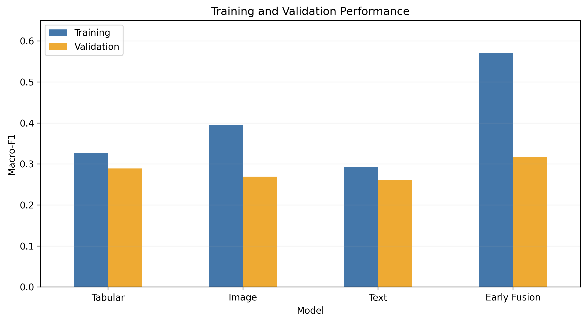
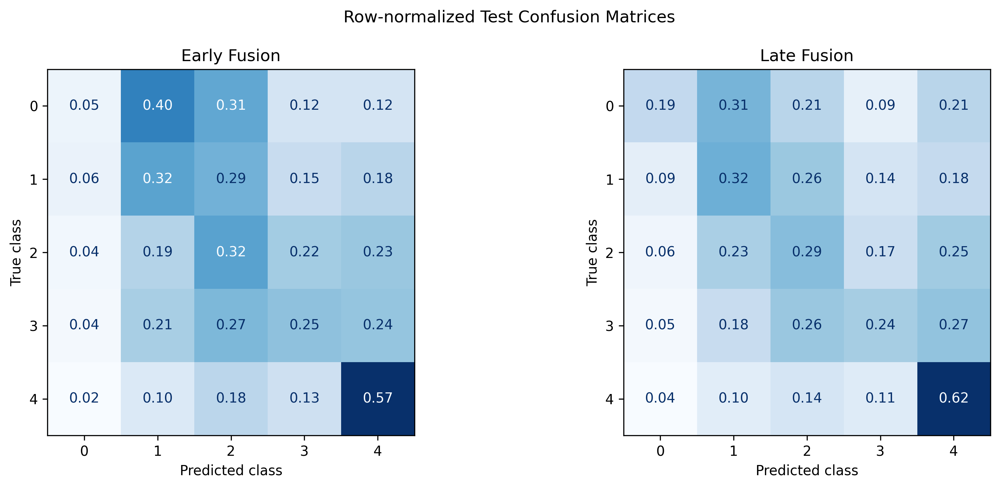

# Multimodal Pet Adoption Speed Prediction

Individual project comparing image, text and tabular baselines with early and late fusion on the PetFinder.my Adoption Prediction dataset. The target is the ordered five-class AdoptionSpeed label (0–4).

## Repository contents

- `PetAdoption_Final.ipynb`: ordered Google Colab workflow; saved cell outputs are cleared to avoid publishing raw listing previews.
- `results/`: aggregate metrics, model-selection tables and figures from the final recorded run.
- `requirements.txt`: recorded analysis-library versions; Colab provides PyTorch, torchvision and Google Drive integration separately.

Original data, per-pet predictions, feature arrays and fitted models are not redistributed.

## Data access

Obtain the data from the [official Kaggle competition](https://www.kaggle.com/competitions/petfinder-adoption-prediction/data), following its access requirements and rules. In Google Drive create this structure:

```text
MyDrive/PetAdoption_Project/data/
    train.csv
    BreedLabels.csv
    ColorLabels.csv
    StateLabels.csv
    train_images.zip
```

The archive must contain the original training JPG files, either directly or inside a folder. The notebook matches each pet to `<PetID>-1.jpg`. Do not upload these source files to this repository.

## Run in Google Colab

1. Upload or open `PetAdoption_Final.ipynb` in Colab.
2. Select a GPU runtime and connect the Drive account containing the data.
3. Use the project path above, or edit `PROJECT_DIR` consistently in the notebook.
4. Colab should provide compatible PyTorch and torchvision builds. The recorded run used PyTorch 2.11.0+cu130 and torchvision 0.26.0+cu130. These builds depend on GPU/runtime availability; do not replace a working Colab GPU stack just to match the suffix.
5. The first cell installs sentence-transformers. For closer environment matching, install `requirements.txt` before running the analysis and restart the runtime if required. Recorded versions are also in `results/experiment_config.json`; exact reproduction across different environments is not guaranteed.
6. Run the notebook cells in order. The first run needs network access to download pretrained encoders. All source data must already be available in Drive.
7. Outputs are written beneath `PetAdoption_Project`: `data/model_data.csv`, `splits/`, `features/`, `models/` and `outputs/`. Local images are extracted to `/content/pet_adoption_images` and must be restored after a Colab reset.

Existing split CSVs are reused, and feature caches are reused after PetID-order checks. To reproduce with existing caches, use the matching original splits. Caches are not automatically invalidated when encoder settings change; use a separate project directory for a deliberately changed experiment. Do not tune against test results.

## Data and methods

The original table has 14,993 listings. Keeping non-empty descriptions and a registered photograph gives 14,640 valid first-image records. A seed-42 stratified 70/15/15 split contains 10,248 training, 2,196 validation and 2,196 test records.

- **Image:** frozen ImageNet-pretrained ResNet18; standard resize, centre crop and normalisation; 512-dimensional features from the first photograph.
- **Text:** frozen `sentence-transformers/paraphrase-multilingual-MiniLM-L12-v2`; 384-dimensional normalised vectors, 256-token limit.
- **Tabular:** five numerical and fourteen categorical fields; training-fitted imputation, scaling and one-hot encoding. PetID, RescuerID and Name are excluded from predictors.
- **Classifiers:** L2-regularised logistic regression. Unimodal C values are 0.1, 1 and 10, with no or balanced class weights.
- **Early fusion:** concatenate processed tabular, scaled image and scaled text features (1,234 dimensions); C values 0.01, 0.1 and 1.
- **Late fusion:** average unimodal probabilities using validation-selected non-negative weights summing to one, searched in 0.1 increments. Final weights are 0.6 tabular, 0.2 image and 0.2 text.

Validation Macro-F1 selects configurations. Weighted-F1 and quadratic weighted kappa (QWK) complement it. Test labels are not used in parameter searches.

## Final recorded test results

| Model | Macro-F1 | Weighted-F1 | QWK |
|---|---:|---:|---:|
| Majority baseline | 0.0858 | 0.1173 | 0.0000 |
| Tabular | 0.2771 | 0.3210 | 0.2404 |
| Image | 0.2778 | 0.3308 | 0.2647 |
| Text | 0.2475 | 0.3118 | 0.1694 |
| Early fusion | 0.2987 | 0.3615 | 0.3015 |
| Late fusion | **0.3151** | **0.3664** | **0.3238** |

The final tabular model uses C=10 and balanced weights. Image, text and early fusion use C=1 without class weighting. Rerunning the tabular pipeline selected a different configuration from an earlier run, affecting late fusion. The tables here consistently describe the final recorded run. Test results were viewed in both runs; this was not a completely untouched confirmatory test.





## Limitations and responsible use

Early fusion shows a substantial training/validation gap. Class-0 detection remains poor: late fusion identifies 11 of 58 test cases, with precision 0.0786. A single split gives no uncertainty estimate or statistical significance test. Rescuers may overlap across subsets; duplicate descriptions and near-duplicate images were not screened across splits. Language and demographic subgroup performance were not evaluated.

No dedicated personal-information redaction was performed before feature extraction. Data should not be described as anonymised. Do not publish notebook outputs that reveal original descriptions or photographs. Predictions are experimental and should not determine access to care or reduce an animal's support.

## Method sources

- [PetFinder.my competition and data](https://www.kaggle.com/competitions/petfinder-adoption-prediction)
- [He et al., Deep Residual Learning for Image Recognition](https://arxiv.org/abs/1512.03385)
- [Torchvision ResNet18 documentation](https://docs.pytorch.org/vision/0.26/models/generated/torchvision.models.resnet18.html)
- [Multilingual MiniLM model card](https://huggingface.co/sentence-transformers/paraphrase-multilingual-MiniLM-L12-v2)
- [LogisticRegression documentation](https://scikit-learn.org/1.6/modules/generated/sklearn.linear_model.LogisticRegression.html)
- [Baltrusaitis et al., Multimodal Machine Learning: A Survey and Taxonomy](https://arxiv.org/abs/1705.09406)
- [QWK implementation documentation](https://scikit-learn.org/1.6/modules/generated/sklearn.metrics.cohen_kappa_score.html)
